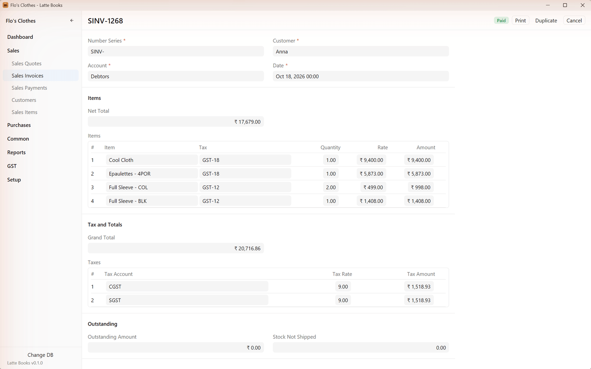
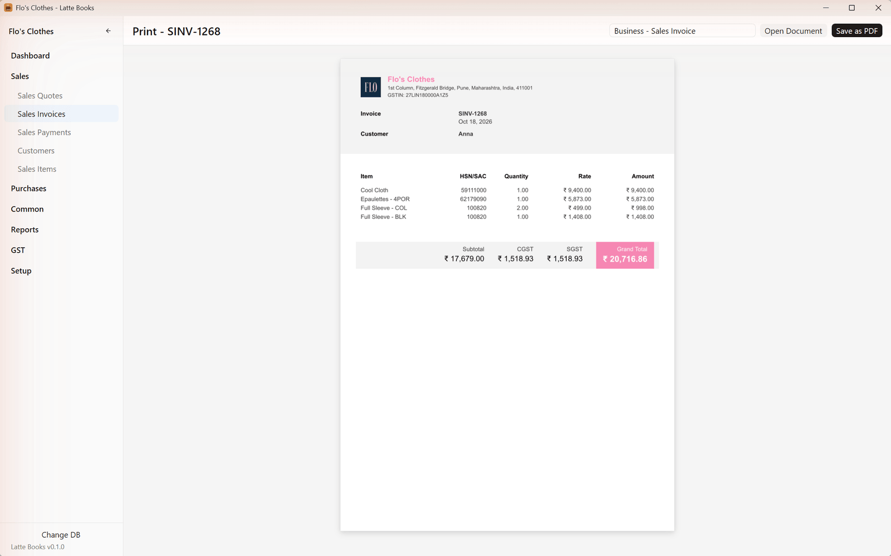
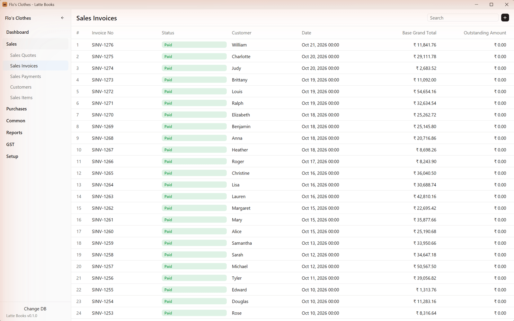
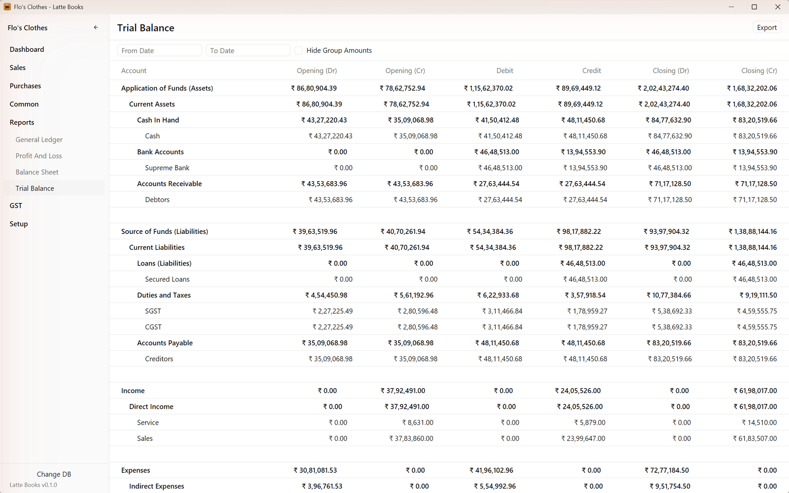

<p align="center">
  
</p>

<p align="center">
  <strong>Free, open-source desktop accounting. A native Rust port of Frappe Books.</strong>
</p>

<p align="center">
  <a href="https://github.com/bloomsynth/latte-books/actions/workflows/ci.yml"></a>
  <a href="LICENSE"></a>
  
  
  <a href="docs/BOOKS-BUGS.md"></a>
</p>

<p align="center">
  <a href="#features">Features</a> ·
  <a href="#coming-from-frappe-books">Coming from Frappe Books</a> ·
  <a href="#getting-started">Getting started</a> ·
  <a href="#ai-assistants">AI assistants</a> ·
  <a href="#status">Status</a> ·
  <a href="CONTRIBUTING.md">Contributing</a>
</p>

---

Frappe has retired the Frappe Books desktop app
([frappe/books#1566](https://github.com/frappe/books/issues/1566)) in favour of a new
Frappe Books on the Frappe Framework, used from a browser. **Latte Books keeps the desktop
app alive.** It is a port of Frappe Books v0.36.0 to Rust that runs on your own computer,
keeps your company in a single file, and opens the files Frappe Books already made.

<p align="center">
  
</p>

## Features

- **Your Frappe Books file, as it is.** Open your `.books.db` and carry on. No export, no
  import, and Frappe Books can still open it afterwards.
- **The same numbers.** The same documents, fields, rules and reports as Frappe Books
  v0.36.0, with the ledger and reports checked against Frappe Books itself.
- **Without Frappe Books' bugs.** Where Frappe Books gets something wrong, Latte fixes it
  instead of copying it: 64 so far, from write-offs posted the wrong way round to payments
  that can't be cancelled. Each is listed in [docs/BOOKS-BUGS.md](docs/BOOKS-BUGS.md) with
  the test that keeps it fixed.
- **Everything Frappe Books does.** Sales and purchases, quotes, payments, journal entries,
  returns, inventory with shipments and receipts, point of sale, pricing rules, coupons and
  loyalty points, data import, custom fields, the dashboard, and reports from the General
  Ledger to the Balance Sheet.
- **India GST and Switzerland** country modules, with GSTR-1 and GSTR-2 reports.
- **Printing to PDF** with Frappe Books' templates and colours, rendered by
  [Typst](https://typst.app/).
- **18 languages,** Frappe Books' community translations, kept as they are.
- **Native and fast.** Written in Rust with [GPUI](https://www.gpui.rs/), the UI framework
  behind the Zed editor. No Electron and no browser engine: the window is up in about half
  a second.
- **AI assistants, if you want them.** Claude, Codex or Cursor can look things up and
  draft documents in your books, with the same checks as the app.
- **Free and open source** under the AGPL-3.0, like Frappe Books.

<table>
  <tr>
    <td width="50%"></td>
    <td width="50%"></td>
  </tr>
  <tr>
    <td align="center"><sub>A sales invoice</sub></td>
    <td align="center"><sub>Its printout, ready to save as PDF</sub></td>
  </tr>
  <tr>
    <td width="50%"></td>
    <td width="50%"></td>
  </tr>
  <tr>
    <td align="center"><sub>Sales invoices</sub></td>
    <td align="center"><sub>The Trial Balance</sub></td>
  </tr>
</table>

<sub>Screenshots show **Create Demo**'s made-up company, Flo's Clothes, as in Frappe Books.</sub>

## Coming from Frappe Books

- **Your company files open as they are.** Latte reads and writes the same SQLite file, and
  adds only a `latte_changes` table that Frappe Books ignores.
- **Try it on a copy first.** Latte is in beta; keep a backup of your company file.
- **Files from Frappe Books v0.36.0.** A file last opened by an older Frappe Books needs
  opening once in v0.36.0 first, as Latte doesn't bring older files up to date yet.
- **Not ported:** ERPNext sync, and right-to-left layout for Arabic and Persian (GPUI has no
  right-to-left support yet).

Every difference from Frappe Books, small or large, is listed in
[docs/DEVIATIONS.md](docs/DEVIATIONS.md).

## Getting started

There are no installers to download yet. To build Latte Books you need
[rustup](https://rustup.rs/), which fetches the Rust version pinned in
`rust-toolchain.toml`, and a GPU.

```sh
git clone https://github.com/bloomsynth/latte-books
cd latte-books
cargo run -p latte-app
```

Then choose **New Company**, open an existing `.books.db` with **Existing Company**, or
choose **Create Demo** to look around a company with a year of made-up sales, purchases and
payments.

<details>
<summary><strong>More to build and run</strong></summary>

Run the tests:

```sh
cargo test --workspace
```

Read a company file from the command line (it is opened read-only):

```sh
cargo run -p latte-db --example dump -- "path/to/company.books.db"
cargo run -p latte-core --example report_test -- "path/to/company.books.db" trial-balance
```

Set up a new company as the setup wizard does (the name must contain "test"):

```sh
cargo run -p latte-core --example setup_test -- "path/to/new test.books.db" India "Acme" "Acme Bank"
```

Make installers with [cargo-packager](https://github.com/crabnebula-dev/cargo-packager)
(not signed yet). They land in `target/packages`, and pushing a `v*` tag builds them on
GitHub for a draft release:

```sh
cargo install cargo-packager --locked
cargo packager --release -p latte-app
```

Try the Phase 0 prototypes:

```sh
cd spikes
cargo run --release -p invoice-grid
cargo run --release -p indic-cjk-text
```

</details>

## AI assistants

**Dime**, Latte's AI layer, lets an assistant work in your books: ask what a customer owes,
run a report, or have it draft an invoice. **Set up AI assistants**, under Setup in the
sidebar, connects Claude Desktop, Claude Code, Codex or Cursor in one click.

- The assistant runs `latte-mcp`, an [MCP](https://modelcontextprotocol.io/) server built
  beside the app, in the company you opened last or the one you choose on that page.
- It goes through the same rules as the app: what you can't save in Latte, it can't
  either.
- New documents are saved as drafts. It shows you a draft and asks before submitting it.
- What it changes shows up in the open app within a couple of seconds.

To try it from a build, run `cargo build` first so `latte-mcp` sits next to `latte-books`.

## Status

**Beta.** The app is built and in use, but not every screen has been checked against Frappe
Books by hand yet, and some of the interface still needs polish.

| Phase | What | Status |
|---|---|---|
| 0 | Foundations, and prototypes to test GPUI | Done |
| 1 | Data layer: read and write `.books.db` files | Done |
| 2 | Accounting engine and reports, checked against Frappe Books | Done |
| 3 | Desktop app: invoices, payments, reports, printing. **Public beta** | Built; in testing |
| 4 | Everything else in Frappe Books v0.36.0: inventory, GST, POS and more. **1.0** | Built; in testing |

The full plan, with what is next, is in [docs/PLAN.md](docs/PLAN.md).

### Known issues

- **Arabic and Persian** are shown left to right.
- **Hindi and Gujarati:** wrapped text can break inside a word, and the arrow keys can stop
  inside a conjunct in text fields. Both come from GPUI and gpui-kit.
- **Exchange rates** aren't fetched: an invoice in another currency has a rate of 1 until
  you set one.
- **A GPU is required.** Virtual machines and Remote Desktop are untested.

## Project layout

| Path | What it holds |
|---|---|
| `crates/latte-schema` | Loads Frappe Books' JSON schemas |
| `crates/latte-db` | SQLite access to `.books.db` files |
| `crates/latte-core` | Accounting rules and reports (no UI) |
| `crates/latte-i18n` | Translations and formatting |
| `crates/latte-print` | PDF printing with Typst |
| `crates/latte-regional` | Country modules (India GST, Switzerland) |
| `crates/latte-ui` | GPUI screens |
| `crates/latte-app` | The `latte-books` executable, its icon and installer settings |
| `crates/latte-mcp` | Dime: the `latte-mcp` server AI assistants run, and their setup |
| `vendor/books` | Files copied unchanged from Frappe Books v0.36.0 |
| `spikes` | Phase 0 prototypes and their results |
| `docs` | The plan, the deviations from Frappe Books and the Frappe Books bugs Latte fixes |

## Contributing

Frappe Books users are especially welcome. If you rely on the desktop app,
[open an issue](https://github.com/bloomsynth/latte-books/issues/new/choose) and say what you
use it for, your country and language, and what you'd miss most: that decides what gets
built and checked first. Bug reports, checks against Frappe Books and pull requests are all
welcome; see [CONTRIBUTING.md](CONTRIBUTING.md).

## License

[AGPL-3.0](LICENSE), the same as Frappe Books. See [NOTICE](NOTICE).

Latte Books is built on Frappe Books by Frappe Technologies and its contributors, including
the volunteers who translated it into 18 languages. It is **not affiliated with Frappe
Technologies**.
