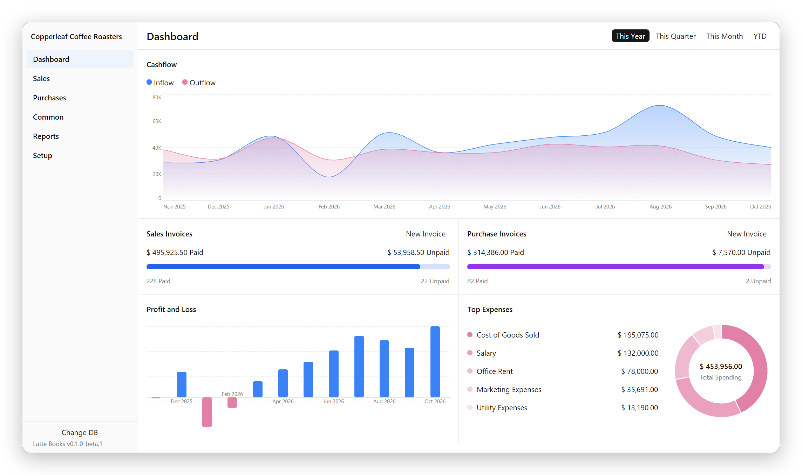
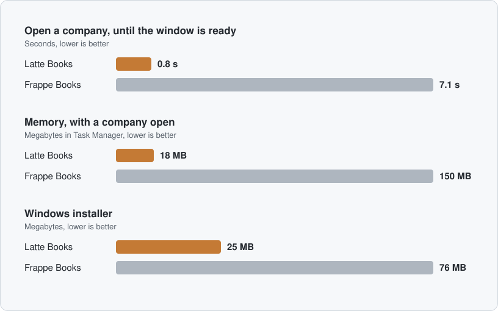

<p align="center">
  
</p>

<p align="center">
  <a href="https://github.com/bloomsynth/latte-books/releases/latest"></a>
  <a href="https://github.com/bloomsynth/latte-books/actions/workflows/ci.yml"></a>
  <a href="LICENSE"></a>
  
</p>

<p align="center">
  <strong>Free, open-source accounting software for your desktop.</strong><br>
  The Frappe Books desktop app, rebuilt in Rust. Opens your existing company files, and
  starts 9× faster in a fraction of the memory.
</p>

<p align="center">
  <a href="https://github.com/bloomsynth/latte-books/releases/latest/download/Latte-Books-Windows-x64-Setup.exe"></a>
  <a href="https://github.com/bloomsynth/latte-books/releases/latest/download/Latte-Books-macOS-arm64.dmg"></a>
  <a href="https://github.com/bloomsynth/latte-books/releases/latest/download/Latte-Books-Linux-x86_64.AppImage"></a>
</p>

<p align="center">
  <sub>Windows 10 or 11 (x64) · macOS on Apple silicon · Linux x86_64 as an AppImage or a
  <a href="https://github.com/bloomsynth/latte-books/releases/latest/download/Latte-Books-Linux-amd64.deb">.deb</a> ·
  installers aren't signed yet, so see the <a href="https://github.com/bloomsynth/latte-books/releases/latest">release notes</a> on first launch</sub>
</p>

<p align="center">
  
</p>

## Why Latte Books

Frappe has [retired the Frappe Books desktop app](https://github.com/frappe/books/issues/1566)
for a new version that runs in the browser. Latte Books keeps the desktop app going: a port
of Frappe Books v0.36.0 to Rust that runs on your computer and keeps your company in a
single file.

- **Your files, as they are.** Open your `.books.db` and carry on. No export or import, and
  Frappe Books can still open it afterwards.
- **Fast and light.** Native code drawn on the GPU, with no Electron or browser inside.
- **The same accounting.** The documents, rules and reports of Frappe Books, with the ledger
  checked against it, and [65 of its bugs fixed](docs/BOOKS-BUGS.md).
- **Free.** There's nothing to pay for, now or later, and the code is open source.
- **Private.** No telemetry or update checks. Your books stay on your computer
  unless you connect an AI assistant.

## Performance

Latte Books 0.1.0-beta.1 against Frappe Books v0.36.0, the Electron app it ports, on the
same Windows PC, both opening the same company file:

<p align="center">
  
</p>

| | Latte Books | Frappe Books | |
|---|---|---|---|
| Open a company, until ready | **0.8 s** | 7.1 s | 9× faster |
| Window on screen | **0.5 s** | 4.1 s | 8× faster |
| Memory, as Task Manager shows it | **18 MB** | 150 MB | 8× less |
| Memory committed | **112 MB** | 292 MB | 2.6× less |
| Processes | **1** | 5 | |
| Windows installer | **25 MB** | 76 MB | 3× smaller |
| Installed on disk | **87 MB** | 249 MB | 2.9× smaller |

How each number was measured, and how to run the tests yourself, is in
[docs/BENCHMARKS.md](docs/BENCHMARKS.md).

## Features

Everything in Frappe Books v0.36.0:

- **Sales and purchases:** quotes, invoices, payments, returns, journal entries
- **Inventory:** stock, shipments and receipts
- **Point of sale,** pricing rules, coupons and loyalty points
- **Reports:** General Ledger, Profit and Loss, Balance Sheet, Trial Balance and more
- **India GST** with GSTR-1 and GSTR-2, and **Switzerland**
- **Print to PDF** with Frappe Books' templates, rendered by [Typst](https://typst.app/)
- **18 languages,** Frappe Books' community translations
- **AI assistants,** optional: Claude, Codex or Cursor can look things up and draft
  documents in your books, under the same rules as the app, and ask before submitting.
  Connect one under **Setup → Set up AI assistants**.


## Coming from Frappe Books

Latte Books is in **beta**: try it on a copy of your company file first.

- **Files from Frappe Books v0.36.0** open as they are. A file last opened by an older
  version needs opening once in v0.36.0 first.
- **Not ported yet:** ERPNext sync, and right-to-left layout for Arabic and Persian.
- **Known issues:** exchange rates aren't fetched; in Hindi and Gujarati, wrapped text can
  break inside a word; and a GPU is required (virtual machines and Remote Desktop are
  untested).

Every difference from Frappe Books is in [docs/DEVIATIONS.md](docs/DEVIATIONS.md), and
what's next is in [docs/PLAN.md](docs/PLAN.md).

## Build from source

You need [rustup](https://rustup.rs/) and a GPU.

```sh
git clone https://github.com/bloomsynth/latte-books
cd latte-books
cargo run -p latte-app
```

Choose **Create Demo** to look around a made-up company. Tests, tools and the project
layout are in [CONTRIBUTING.md](CONTRIBUTING.md).

## Contributing

Frappe Books users are especially welcome.
[Open an issue](https://github.com/bloomsynth/latte-books/issues/new/choose) to say what you
use it for and what you'd miss most: that decides what gets checked first. If you'd like the
desktop app to live on, **star the repository** so other Frappe Books users can find it.

## License

[AGPL-3.0](LICENSE), like Frappe Books. Latte Books is built on Frappe Books by Frappe
Technologies and its contributors, including the volunteers who translated it. It is
**not affiliated with Frappe Technologies**. See [NOTICE](NOTICE).
