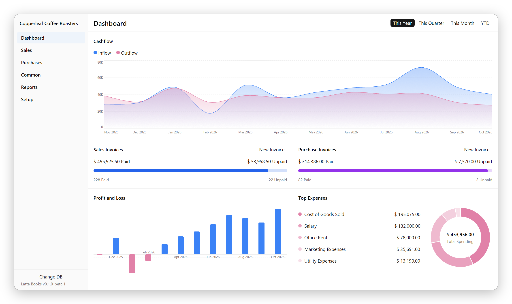
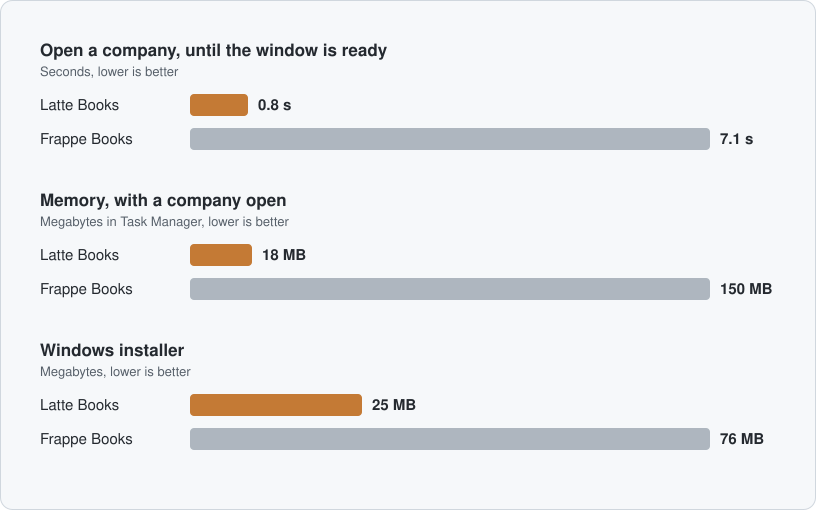

<p align="center">
  
</p>

<p align="center">
  <a href="https://github.com/bloomsynth/latte-books/releases/latest"></a>
  <a href="https://github.com/bloomsynth/latte-books/actions/workflows/ci.yml"></a>
  <a href="LICENSE"></a>
  
</p>

<p align="center">
  <strong>Accounting software for the AI era.</strong><br>
  Fast, free and open source, on your own desktop. Keep your books yourself, or let your
  AI assistant keep them with you.
</p>

<p align="center">
  <a href="https://github.com/bloomsynth/latte-books/releases/latest/download/Latte-Books-Windows-x64-Setup.exe"></a>
  <a href="https://github.com/bloomsynth/latte-books/releases/latest/download/Latte-Books-macOS-arm64.dmg"></a>
  <a href="https://github.com/bloomsynth/latte-books/releases/latest/download/Latte-Books-Linux-x86_64.AppImage"></a>
</p>

<p align="center">
  <sub>Windows 10 or 11 (x64) · macOS on Apple silicon · Linux x86_64 as an AppImage or a
  <a href="https://github.com/bloomsynth/latte-books/releases/latest/download/Latte-Books-Linux-amd64.deb">.deb</a> ·
  installers aren't signed yet, so see the <a href="https://github.com/bloomsynth/latte-books/releases/latest">release notes</a> on first launch</sub>
</p>

<p align="center">
  <strong>Starts in under a second</strong> &nbsp;·&nbsp; <strong>Uses less memory than a browser tab</strong> &nbsp;·&nbsp; <strong>A 25 MB download</strong>
</p>

<p align="center">
  
</p>

## Why Latte Books

- **Built for speed.** Made to be one of the fastest accounting apps you can install.
  Written from scratch in Rust, Latte Books opens in under a second.
- **Built for AI.** Ask your books questions, draft invoices or record a month of bills
  in plain words, from the AI assistant you already use. It asks you before anything is
  posted to your accounts. Connect one in a click:
  -  Claude
  - <picture><source media="(prefers-color-scheme: dark)" srcset="docs/images/assistants/chatgpt-dark.svg"></picture> ChatGPT Codex
  - <picture><source media="(prefers-color-scheme: dark)" srcset="docs/images/assistants/cursor-dark.svg"></picture> Cursor
- **Complete accounting.** Sales, purchases, payments, inventory, point of sale, GST and
  the reports your accountant asks for, in one app.
- **Your books, on your computer.** Each company is a single file you own. There's no
  account, no telemetry and no cloud, unless you connect an AI assistant. The app only
  goes online to check for a new version, which you can turn off in Settings.
- **Free and open source.** Nothing to pay for, now or later, under the AGPL.
- **Actively developed.** New features and fixes land every week, and the app updates
  itself in a click: see the [changelog](CHANGELOG.md).

## Built for speed

Latte Books is optimized from the ground up:

- **Opens in under a second,** ready to work.
- **Uses about 18 MB of memory,** less than a single browser tab.
- **A 25 MB download,** under 90 MB once installed.

What makes it this fast:

- **Native code.** Rust compiles straight to machine code, so there's nothing to load or
  warm up.
- **Drawn on the GPU** by [GPUI](https://www.gpui.rs/), the framework behind the Zed
  editor. Long lists and reports draw only the rows on screen, so they scroll smoothly.
- **Lightweight.** The whole app is one small program that uses very little memory.
- **Offline and private.** Everything runs on your computer, with no server and no
  internet needed, and your books never leave it. The app only goes online to check for
  updates and to send an anonymous [usage count](#usage-counts), and you can turn off
  both.

## Your books, with your AI assistant

Latte Books is made to be worked from an AI assistant as well as by hand. Open
**Tools → AI Assistants** and press **Connect** beside yours:

-  Claude Desktop
-  Claude Code
- <picture><source media="(prefers-color-scheme: dark)" srcset="docs/images/assistants/chatgpt-dark.svg"></picture> ChatGPT Codex
- <picture><source media="(prefers-color-scheme: dark)" srcset="docs/images/assistants/cursor-dark.svg"></picture> Cursor

In the ChatGPT app, use a Codex or Work chat:
ordinary ChatGPT chats can't reach apps on your computer yet.

Then talk to your books:

- *"What does Acme owe us, and since when?"*
- *"Invoice Acme for 10 chairs at ₹2,500, with 18% GST."*
- *"Here's a folder of this month's supplier bills. Record them as purchases."*
- *"Run the Profit and Loss for this quarter and tell me what changed."*
- *"What do I need to file in GSTR-3B for October?"*

The assistant works through the app, so it can't do anything you couldn't do yourself.
An invoice with missing details or a journal entry that doesn't balance won't save. New
documents start as drafts, and it asks you before posting anything to your accounts.

Latte Books doesn't come with an AI or charge for one. You use the assistant you already
have, and nothing is connected until you press Connect.

## Features

- **Sales and purchases:** quotes, invoices, payments, returns and journal entries,
  in any currency
- **Inventory:** items, stock, locations, shipments and purchase receipts
- **Point of sale,** with pricing rules, coupons and loyalty points
- **Reports:** General Ledger, Profit and Loss, Balance Sheet, Trial Balance, Stock
  Ledger and Stock Balance, to print or save as CSV
- **India GST:** GSTR-1 and GSTR-3B by month, or by quarter for QRMP, as the GST portal
  files them, with their due dates. GSTR-1 exports the whole return for the GST portal,
  HSN summary and documents issued included. Purchases under the **reverse charge**, such
  as services bought from abroad, post the GST you owe and the credit you claim, and
  print a self-invoice
- **Charts of accounts** for 12 countries, and a standard one for the rest
- **Print to PDF** with templates you can edit, rendered by [Typst](https://typst.app/)
- **Import** parties, items and documents from CSV files
- **18 languages,** with community translations

## Status

Latte Books is in **beta**: keep a copy of your company file while you try it.

- **Not built yet:** right-to-left layout for Arabic and Persian.
- **Known issues:** exchange rates aren't fetched; in Hindi and Gujarati, wrapped text can
  break inside a word; and a GPU is required (virtual machines and Remote Desktop are
  untested).

What's next is in [docs/PLAN.md](docs/PLAN.md).

## Usage counts

Once a day, Latte Books sends Bloomsynth an anonymous count of its use, so we know how
many people use it and which features matter. This is everything it sends:

| Field | Example |
|---|---|
| A random ID, made on first run and linked to nothing else | `5f0c…9a1e` |
| The app's version | `0.1.0-beta.5` |
| Your system and processor type | `windows`, `x86_64` |
| The app's language | `English` |
| The features you opened since the last count, by name | `pos`, `doc:SalesInvoice`, `report:GSTR1`, `export:GSTR1:json` |
| The AI assistants you've connected | `assistant:ClaudeDesktop` |

It never sends your company's name, GSTIN, parties, items, amounts, documents or file
paths. The service keeps the country the count came from, not your IP address.

- Nothing is sent until the app has told you about it, the first time you open a company.
- Turn it off in **Settings → System → Advanced → Send anonymous usage counts**. That also
  forgets the random ID and anything not yet sent.
- The code that sends it is [crates/latte-ui/src/telemetry.rs](crates/latte-ui/src/telemetry.rs).
  The service that receives it, at telemetry.bloomsynth.com, uses your IP address only to
  find the country and to limit how often one address can send. It never stores or logs it.
- Copies built from source don't send anything.

## Coming from Frappe Books

Latte Books began as a rebuild of the [Frappe Books](https://github.com/frappe/books)
desktop app, which Frappe has
[retired](https://github.com/frappe/books/issues/1566) for a version that runs in the
browser. It is written from scratch in Rust and keeps Frappe Books' file format, so you
can switch without losing anything:

- **Your files open as they are.** Open your `.books.db` from Frappe Books v0.36.0 and
  carry on, with no export or import, and Frappe Books can still open it afterwards. A
  file last opened by an older version needs opening once in v0.36.0 first.
- **The same accounting, with fixes.** The ledger is checked against Frappe Books, and
  [80 of its bugs are fixed](docs/BOOKS-BUGS.md). Every difference is in
  [docs/DEVIATIONS.md](docs/DEVIATIONS.md).
- **Not carried over:** ERPNext sync.

It is also much faster and lighter. On the same Windows PC, opening the same company
file, against Frappe Books v0.36.0:

<p align="center">
  
</p>

| | Latte Books | Frappe Books | |
|---|---|---|---|
| Open a company, until ready | **0.8 s** | 7.1 s | 9× faster |
| Window on screen | **0.5 s** | 4.1 s | 8× faster |
| Memory, as Task Manager shows it | **18 MB** | 150 MB | 8× less |
| Memory committed | **112 MB** | 292 MB | 2.6× less |
| Processes | **1** | 5 | |
| Windows installer | **25 MB** | 76 MB | 3× smaller |
| Installed on disk | **87 MB** | 249 MB | 2.9× smaller |

How each number was measured, and how to run the tests yourself, is in
[docs/BENCHMARKS.md](docs/BENCHMARKS.md).

## Build from source

You need [rustup](https://rustup.rs/) and a GPU.

```sh
git clone https://github.com/bloomsynth/latte-books
cd latte-books
cargo run -p latte-app
```

Choose **Create Demo** to look around a made-up company. Tests, tools and the project
layout are in [CONTRIBUTING.md](CONTRIBUTING.md).

## Contributing

[Open an issue](https://github.com/bloomsynth/latte-books/issues/new/choose) to say what you
use Latte Books for and what you'd like it to do next: that decides what gets built first.
If you like where it's going, **star the repository** so others can find it.

## License

[AGPL-3.0](LICENSE). Latte Books grew out of Frappe Books by Frappe Technologies and its
contributors, including the volunteers who translated it. It is **not affiliated with
Frappe Technologies**. See [NOTICE](NOTICE).
